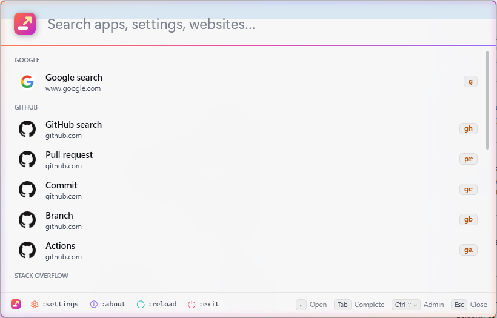

# AltSpacy

A keyboard launcher for Windows. Press **Alt+Space**, type a few letters, press **Enter**.



- **Site shortcuts**: `g weather` searches Google, `gh altspacy` searches GitHub, `pr dotnet/runtime 1190` opens that
  pull request. Add your own for any site, such as Jira, Confluence or an internal GitLab.
- **Anything Win+R can run**: apps, consoles and settings pages by name (`notepad`, `services`, `env`), with their
  real icons. **Ctrl+Shift+Enter** runs as administrator.
- **Windows actions**: switch dark/light mode and other common tasks.
- **Calculator**: type `12*7+3` and press Enter to copy the result.
- **People and links**: type an email to chat in Teams or send a mail, `t name` to find someone in Teams, or a web
  address to open it.
- **Clipboard suggestions**: a copied link or issue key shows up ready to open.
- **Learns what you use**: frequent items rise to the top.

Light and dark themes follow Windows. AltSpacy lives in the tray; right-click the icon for Settings.

## Download

Get the latest version from the [Releases page](../../releases/latest). There are two downloads of the same app:

| Download | Size | Pick it if |
|---|---|---|
| `AltSpacy-<version>-x64-dotnet10.exe` | under 1 MB | You have the .NET 10 Desktop Runtime (or newer) installed. |
| `AltSpacy-<version>-x64-standalone.exe` | about 75 MB | You don't, or you're not sure. Nothing else to install. |

To check, run `dotnet --list-runtimes` in a terminal. A line starting with `Microsoft.WindowsDesktop.App 10.` or
higher means the small download will work. If the small one can't find .NET, Windows offers a link to install it.

Both are portable: save the exe anywhere and run it. Windows SmartScreen may warn about an unrecognized app because
the exe isn't code-signed yet: choose **More info > Run anyway**. Each release lists SHA-256 checksums in
`SHA256SUMS.txt`.

Requires 64-bit Windows 10 or 11.

## Using it

| Keys | Does |
|---|---|
| **Alt+Space** | Open or close the bar (change it in Settings) |
| **Enter** | Open the selected item |
| **Tab** | Complete the shortcut key |
| **Ctrl+Shift+Enter** | Run as administrator |
| **Esc** | Close |

Type `:settings`, `:about`, `:reload` or `:exit` in the bar for those commands. Settings can also start AltSpacy with
Windows (it starts hidden in the tray).

### Your shortcuts

Shortcuts live in `%APPDATA%\AltSpacy\shortcuts.json`. Edit them in Settings or in the file (changes apply on save):

```jsonc
{
  "projects": { "runtime": "dotnet/runtime" },
  "shortcuts": [
    { "key": "g",  "description": "Google search", "url": "https://www.google.com/search?q={q}" },
    { "key": "pr", "description": "Pull request",  "url": "https://github.com/{project}/pull/{q}" },
    { "key": "j",  "description": "Jira issue",    "url": "https://your-company.atlassian.net/browse/{q}", "prefixIfNumeric": "PROJ-" }
  ]
}
```

| In the URL | Becomes |
|---|---|
| `{q}` | What you typed after the key, URL-encoded, without surrounding quotes |
| `{raw}` | What you typed, exactly, URL-encoded |
| `{project}` | The first word if it is an alias in `projects` or an `owner/repo` path, else the shortcut's `defaultProject` |

`prefixIfNumeric` is added to digits-only values, so `j 41` opens `PROJ-41`. Each shortcut shows the site's icon;
set `icon` to an image URL or file to override it.

AltSpacy keeps its data in `%APPDATA%\AltSpacy` (shortcuts, history, icon cache, log). Set `ALTSPACY_HOME` to use another
folder.

## Building from source

You need the [.NET SDK](https://dotnet.microsoft.com/download) 10 or newer on Windows.

```powershell
dotnet test AltSpacy.slnx              # all tests (window tests open real windows off-screen)
dotnet run --project src/AltSpacy      # run the app
./build.ps1                           # tests + both release exes in dist\release, with checksums
```

### Releasing

1. Bump `<Version>` in `src/AltSpacy/AltSpacy.csproj` and add a matching first entry to `ReleaseNotes.All` in
   `src/AltSpacy/SmartInput.cs` (a test checks they match; the note appears in About and on the release page).
2. Merge to `main`, then tag: `git tag v1.5.0` and `git push origin v1.5.0`.
3. The Release workflow tests, builds both exes and publishes the GitHub release with checksums.

## Contributing

Issues and pull requests are welcome. Please run `dotnet test AltSpacy.slnx` before sending changes. By contributing you
agree that your contributions are licensed under the GPL-3.0, like the rest of the project.

## License

Copyright © 2026 Vaibhav Sharma

AltSpacy is free software: you can redistribute it and/or modify it under the terms of the
[GNU General Public License, version 3](LICENSE), as published by the Free Software Foundation.

AltSpacy is distributed in the hope that it will be useful, but WITHOUT ANY WARRANTY; without even the implied warranty
of MERCHANTABILITY or FITNESS FOR A PARTICULAR PURPOSE. See the GNU General Public License for more details.

As an additional term under section 7(e) of the license, the license does not grant rights to use the AltSpacy name or
logo; see [TRADEMARKS.md](TRADEMARKS.md). Third-party components are listed in
[THIRD-PARTY-NOTICES.md](THIRD-PARTY-NOTICES.md).
